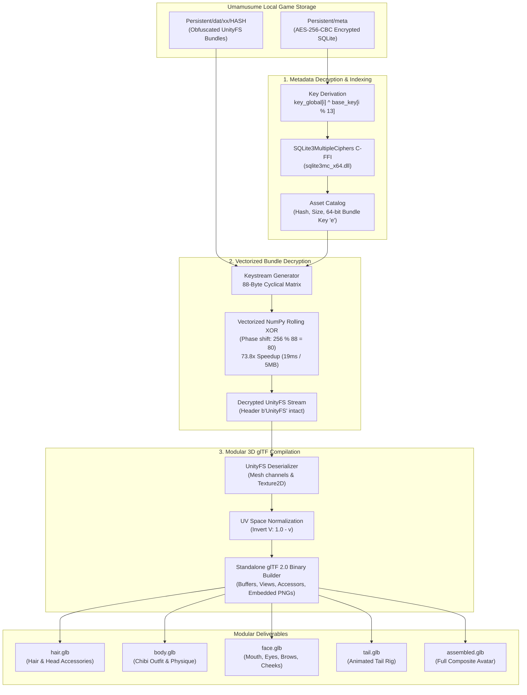

# uma-chibi-re

[](https://www.python.org/)
[](LICENSE)
[](https://www.khronos.org/gltf/)
[-purple.svg)]()

High-performance, offline reverse engineering and 3D asset extraction pipeline for **Umamusume: Pretty Derby** Chibi (mini) character models.

Bypasses multi-layer client-side security (AES-256-CBC SQLite database encryption and rolling 88-byte XOR keystream de-obfuscation) to extract modular 3D components directly into Khronos-compliant binary **glTF 2.0 (`.glb`)** containers ready for Blender, Godot, Unity, or Windows 3D Viewer.

---

## Technical Architecture



---

## Key Reverse Engineering Discoveries

### 1. SQLite3MultipleCiphers AES-256-CBC (`meta`)
The client's asset catalog (`Persistent/meta`) is encrypted with SQLite3MultipleCiphers in CBC mode. Standard SQLite drivers fail with `file is not a database`. The encryption key is derived by cyclical XOR between two hardcoded byte vectors:

$$\text{Key}[i] = \text{Key}_{\text{global}}[i] \oplus \text{Key}_{\text{base}}[i \pmod{13}]$$

- $\text{Key}_{\text{base}}$ (13 bytes): `[0xF1, 0x70, 0xCE, 0xA4, 0xDF, 0xCE, 0xA3, 0xE1, 0xA5, 0xD8, 0xC7, 0x0B, 0xD1]`
- $\text{Key}_{\text{global}}$ (33 bytes): `[0x36, 0x23, 0x6B, 0x4C, 0x2A, 0x39, ... 0x37, 0x24, 0x53]`

The resulting 33-byte key is passed to `sqlite3_key` via C-FFI (`ctypes`) to open table `a` containing asset paths, hashes, and per-bundle encryption seeds.

### 2. UnityFS 88-Byte Rolling XOR Scheme
Asset bundles in `Persistent/dat/{hash[:2]}/{hash}` utilize a selective stream cipher:
- **Bytes `0..255`**: Unencrypted raw headers (`UnityFS\x00...`), preserving directory block offsets.
- **Bytes `256..end`**: Rolling XOR against an 88-byte schedule generated from Cygames' 11-byte base array and the asset's specific 64-bit integer key $e$:

$$K[8i + j] = \text{BaseKeys}[i] \oplus e_{\text{bytes}}[j] \quad (0 \le i < 11, \; 0 \le j < 8)$$

### 3. Vectorized Keystream Acceleration (73.8x Speedup)
Standard byte-by-byte Python loops require over 1.4 seconds per 5 MB bundle. By mapping the array to NumPy uint8 buffers and tiling the 88-byte keystream with phase offset $(256 \pmod{88} = 80)$:

```python
start_phase = 256 % 88  # 80
keystream = np.tile(schedule, (payload_len // 88) + 2)[start_phase : start_phase + payload_len]
buffer[256:] ^= keystream
```

Decryption throughput drops from **1,436 ms** down to **19.4 ms** (a **73.8x performance increase**).

---

## Installation

### Prerequisites
- Python 3.9+
- Windows x64 (tested on Windows 10/11)
- Installed Umamusume Pretty Derby (Steam or DMM client)

```bash
git clone https://github.com/lunizura/uma-chibi-re.git
cd uma-chibi-re
pip install -r requirements.txt
```

---

## Usage

### 1. Scan Local Chibi Models
Scans your local game cache and displays an indexed table of discovered character models, hashes, and encryption keys:

```bash
python -m cli.main list
```

### 2. Extract Modular 3D Components
Extracts a character into separate modular `.glb` models and a unified assembled avatar:

```bash
# Extract Special Week (1001_00)
python -m cli.main extract 1001_00 -o exports

# Extract Gold Ship (1007_00) with custom outfit
python -m cli.main extract 1007_00 -o exports --body 0002_00
```

#### Generated Outputs (`exports/chibi_1001_00/`)
| File | Size | Description |
| :--- | :--- | :--- |
| `hair.glb` | ~108 KB | Character hair mesh, ears, ribbons, and diffuse texture |
| `body.glb` | ~311 KB | Outfit mesh, arms, shoes, and uniform texture |
| `face.glb` | ~68 KB | Face geometry (eyes, brows, cheeks, mouth expressions) |
| `tail.glb` | ~10 KB | Tail rig and hair gradient texture |
| `assembled.glb` | ~497 KB | Complete multi-node scene with all components aligned |

### 3. Run Automated Tests
Executes the full test suite validating crypto reversibility, database queries, and binary glTF compliance:

```bash
python -m cli.main test
```

---

## Modular Blender Import Workflow
All generated `.glb` files follow the Khronos glTF 2.0 specification:
1. Open **Blender** (3.0+).
2. Go to **File -> Import -> glTF 2.0 (.glb/.gltf)**.
3. Select `assembled.glb` for the full character, or import `hair.glb`, `body.glb`, `face.glb`, and `tail.glb` as separate objects for custom kitbashing, rigging, or VRChat avatar creation.

---

## Research Boundaries & Legal Notice
- **No Copyrighted Files**: This repository contains **zero copyrighted 3D meshes, textures, audio, or game binaries**.
- **Offline Client Operation**: This software runs strictly offline against files already downloaded by the legal game client on the user's local machine. It does not interface with Cygames servers, inject into live game memory, or modify game execution.
- **Educational & Interoperability Research**: Provided strictly for reverse engineering education, data format research, and personal 3D modeling interoperability under fair use principles.

---

## Author
Built by **[lunizura](https://github.com/lunizura)** (`izu`) — Cybersecurity & Systems Engineering.
